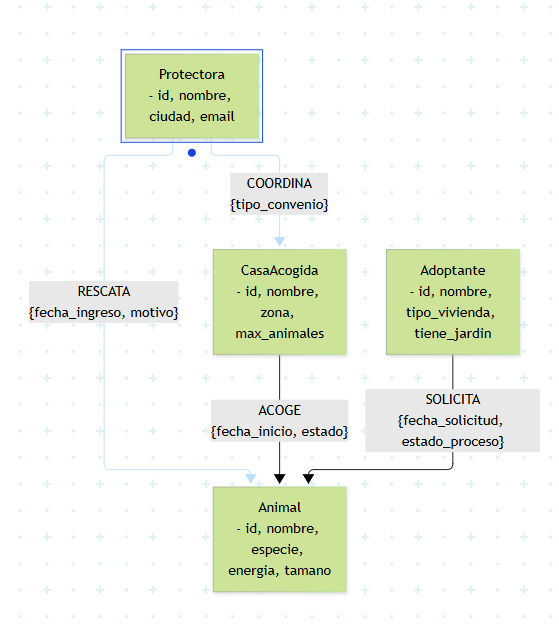

# 2. Diseñar el grafo de nodos y relaciones

## 2.1 Diagrama visual del modelo (Mermaid)

## 2.2 Etiquetas de nodos y propiedades (con campos obligatorios)
1. **`:Animal`** (Mascota rescatada)
   - `id` (String, **Obligatorio**): Identificador único (ej. `"ANI-01"`).
   - `nombre` (String, **Obligatorio**): Nombre del animal.
   - `especie` (String, **Obligatorio**): Perro, gato, etc.
   - `raza` (String, Opcional).
   - `edad_meses` (Integer, **Obligatorio**): Edad estimada en meses.
   - `nivel_energia` (Integer, **Obligatorio**): Escala del 1 al 5.
   - `tamano` (String, **Obligatorio**): Pequeño, mediano, grande.
   - `sociable_ninos` (Boolean, **Obligatorio**).
   - `sociable_otros` (Boolean, **Obligatorio**).

2. **`:Protectora`** (Refugio u organización de rescate)
   - `id` (String, **Obligatorio**): Identificador único (ej. `"REF-01"`).
   - `nombre` (String, **Obligatorio**): Nombre de la protectora.
   - `ciudad` (String, **Obligatorio**).
   - `email` (String, **Obligatorio**).

3. **`:CasaAcogida`** (Familias o voluntarios temporales)
   - `id` (String, **Obligatorio**): Identificador único (ej. `"CAS-01"`).
   - `nombre` (String, **Obligatorio**).
   - `zona` (String, **Obligatorio**): Zona o barrio.
   - `espacio_vivienda` (String, **Obligatorio**): Piso, chalet, etc.
   - `tiene_ninos` (Boolean, **Obligatorio**).
   - `max_animales` (Integer, **Obligatorio**): Capacidad máxima simultánea.
   - `estado_disponible` (Boolean, **Obligatorio**).

4. **`:Adoptante`** (Usuarios interesados en adoptar)
   - `id` (String, **Obligatorio**): Identificador único (ej. `"USR-01"`).
   - `nombre` (String, **Obligatorio**).
   - `email` (String, **Obligatorio**).
   - `tipo_vivienda` (String, **Obligatorio**): Piso, chalet, etc.
   - `tiene_jardin` (Boolean, **Obligatorio**).
   - `experiencia_previa` (Boolean, **Obligatorio**).

## 2.3 Tipos de relación, dirección y propiedades
- **`(:Protectora)-[:RESCATA {fecha_ingreso: Date, motivo: String}]->(:Animal)`**: Indica qué organización rescató al animal y en qué fecha.
- **`(:CasaAcogida)-[:ACOGE {fecha_inicio: Date, fecha_fin: Date, estado: String}]->(:Animal)`**: Guarda el historial temporal de estancias en hogares de acogida.
- **`(:Adoptante)-[:SOLICITA {fecha_solicitud: Date, estado_proceso: String}]->(:Animal)`**: Conecta al interesado con la mascota para registrar el proceso de adopción.
- **`(:Protectora)-[:COORDINA {tipo_convenio: String}]->(:CasaAcogida)`**: Enlaza el refugio con las casas colaboradoras que gestiona.

## 2.4 Justificación de nodos frente a propiedades
- **¿Por qué Protectora, CasaAcogida y Adoptante son nodos y no simples atributos de texto?** Porque son entidades con identidad propia, con datos que evolucionan de forma independiente (como el cambio de disponibilidad de una casa o el contacto de un adoptante) y porque múltiples animales se relacionan con ellos a lo largo del tiempo. Modelarlos como nodos evita la duplicación masiva de datos y permite recorrer las conexiones físicas en milisegundos.
- **¿Por qué el Animal es el nodo central?** Porque actúa como el nexo que une a la protectora que lo rescató, la casa temporal que lo aloja y el adoptante que solicita su adopción.

## 2.5 Identificadores únicos y tipos de datos compatibles con Cypher
- Se utilizan códigos alfanuméricos estandarizados como claves de negocio (`"ANI-01"`, `"REF-01"`, `"CAS-01"`, `"USR-01"`), respaldados por restricciones de unicidad (`IS UNIQUE`).
- Tipos de datos nativos de Cypher empleados: `String` para textos y nombres, `Integer` para escalas numéricas y edades, `Boolean` para condiciones lógicas de compatibilidad (`sociable_ninos`, `tiene_jardin`), y `Date` para el registro temporal de ingresos y solicitudes.

## 2.6 Límites y riesgos del modelo (Supernodos y operaciones no recomendables)
- **Prevención de supernodos:** Protectoras muy grandes con miles de animales rescatados acumulados a lo largo de los años pueden convertir el nodo de la protectora en un supernodo con miles de conexiones directas, ralentizando las búsquedas. Para evitarlo, las consultas nunca parten de la protectora en abierto, sino de filtros geográficos o del identificador directo del animal, acotando siempre la profundidad de los saltos (`*1..3`).
- **Operaciones no recomendables en un grafo:** No se deben ejecutar escaneos globales sin filtros iniciales (`MATCH (n) RETURN n`) ni recorridos de longitud variable ilimitada (`-[:RESCATA*]-`) sobre nodos muy conectados, ya que obligan al motor a procesar un volumen masivo de caminos innecesarios en memoria RAM. 