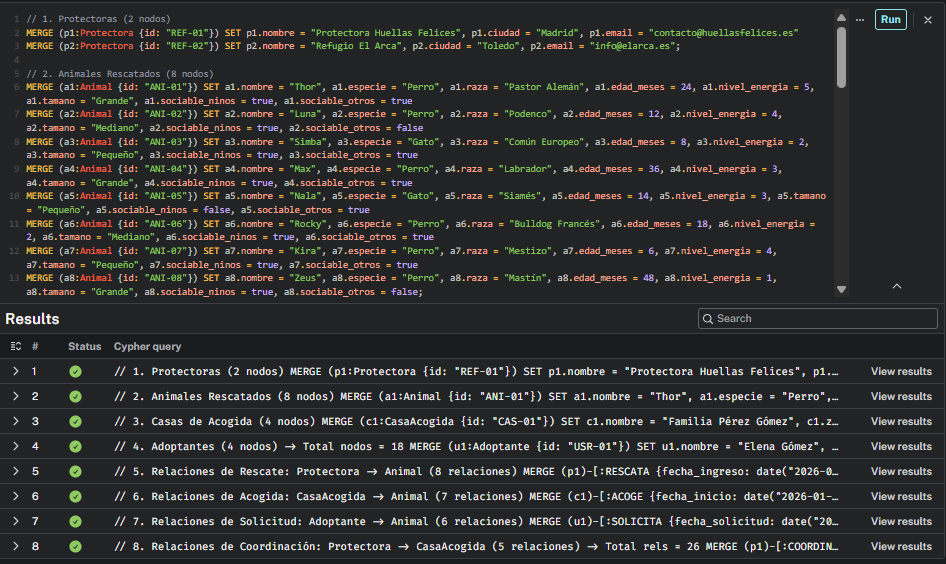
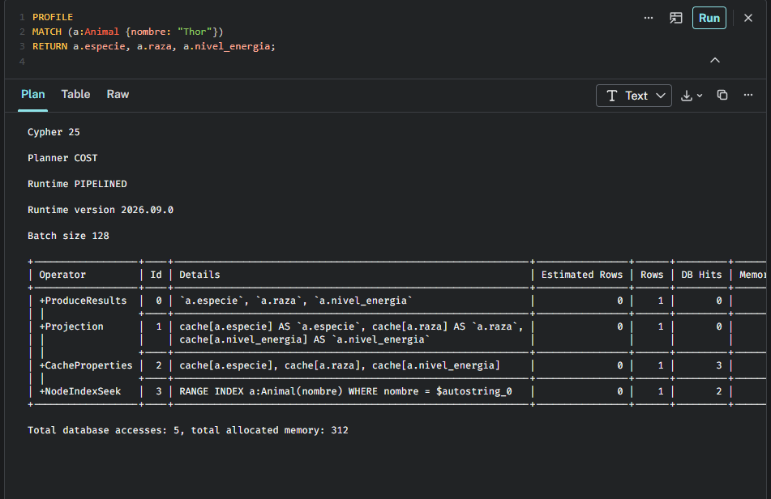
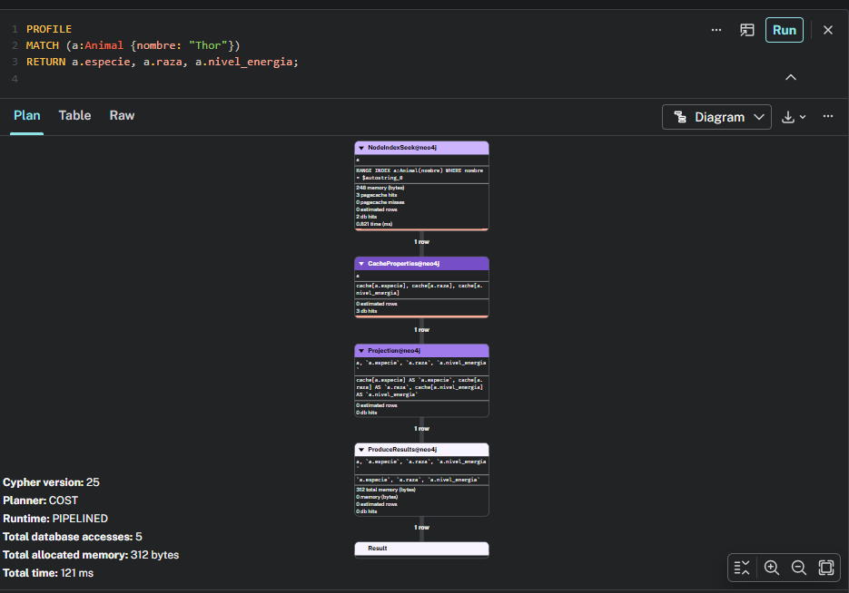

# 3. Implementar restricciones, índices y carga de datos

## 3.1 Creación de restricciones de unicidad
Garantizan la integridad de los identificadores principales y crean automáticamente un índice B-Tree subyacente para un acceso instantáneo:

```cypher
// 1. Unicidad de Animales por ID
CREATE CONSTRAINT c_animal_id IF NOT EXISTS
FOR (a:Animal) REQUIRE a.id IS UNIQUE;

// 2. Unicidad de Protectoras por ID
CREATE CONSTRAINT c_protectora_id IF NOT EXISTS
FOR (p:Protectora) REQUIRE p.id IS UNIQUE;

// 3. Unicidad de Casas de Acogida por ID
CREATE CONSTRAINT c_casa_id IF NOT EXISTS
FOR (c:CasaAcogida) REQUIRE c.id IS UNIQUE;

// 4. Unicidad de Adoptantes por ID
CREATE CONSTRAINT c_adoptante_id IF NOT EXISTS
FOR (u:Adoptante) REQUIRE u.id IS UNIQUE;
```

## 3.2 Creación de índices secundarios
Optimizan las búsquedas frecuentes por campos clave desde la aplicación sin necesidad de recorrer todo el grafo:

```cypher
// Búsqueda rápida de animales por su nombre
CREATE INDEX idx_animal_nombre IF NOT EXISTS
FOR (a:Animal) ON (a.nombre);

// Búsqueda de protectoras por ciudad
CREATE INDEX idx_protectora_ciudad IF NOT EXISTS
FOR (p:Protectora) ON (p.ciudad);

// Búsqueda de casas de acogida por zona
CREATE INDEX idx_casa_zona IF NOT EXISTS
FOR (c:CasaAcogida) ON (c.zona);
```

## 3.3 Script de carga de datos completo e idempotente (`MERGE`)
Este script se puede ejecutar varias veces sin duplicar nodos ni relaciones gracias al uso de `MERGE` y `SET`. Incluye un dataset de prueba con más de 15 nodos y 25 relaciones conectadas. 

*(Nota para la ejecución: Ejecuta todo este script 3.3 de una sola vez en tu Neo4j)*:

```cypher
// 1. Protectoras (2 nodos)
MERGE (p1:Protectora {id: "REF-01"}) SET p1.nombre = "Protectora Huellas Felices", p1.ciudad = "Madrid", p1.email = "contacto@huellasfelices.es"
MERGE (p2:Protectora {id: "REF-02"}) SET p2.nombre = "Refugio El Arca", p2.ciudad = "Toledo", p2.email = "info@elarca.es";

// 2. Animales Rescatados (8 nodos)
MERGE (a1:Animal {id: "ANI-01"}) SET a1.nombre = "Thor", a1.especie = "Perro", a1.raza = "Pastor Alemán", a1.edad_meses = 24, a1.nivel_energia = 5, a1.tamano = "Grande", a1.sociable_ninos = true, a1.sociable_otros = true
MERGE (a2:Animal {id: "ANI-02"}) SET a2.nombre = "Luna", a2.especie = "Perro", a2.raza = "Podenco", a2.edad_meses = 12, a2.nivel_energia = 4, a2.tamano = "Mediano", a2.sociable_ninos = true, a2.sociable_otros = false
MERGE (a3:Animal {id: "ANI-03"}) SET a3.nombre = "Simba", a3.especie = "Gato", a3.raza = "Común Europeo", a3.edad_meses = 8, a3.nivel_energia = 2, a3.tamano = "Pequeño", a3.sociable_ninos = true, a3.sociable_otros = true
MERGE (a4:Animal {id: "ANI-04"}) SET a4.nombre = "Max", a4.especie = "Perro", a4.raza = "Labrador", a4.edad_meses = 36, a4.nivel_energia = 3, a4.tamano = "Grande", a4.sociable_ninos = true, a4.sociable_otros = true
MERGE (a5:Animal {id: "ANI-05"}) SET a5.nombre = "Nala", a5.especie = "Gato", a5.raza = "Siamés", a5.edad_meses = 14, a5.nivel_energia = 3, a5.tamano = "Pequeño", a5.sociable_ninos = false, a5.sociable_otros = true
MERGE (a6:Animal {id: "ANI-06"}) SET a6.nombre = "Rocky", a6.especie = "Perro", a6.raza = "Bulldog Francés", a6.edad_meses = 18, a6.nivel_energia = 2, a6.tamano = "Mediano", a6.sociable_ninos = true, a6.sociable_otros = true
MERGE (a7:Animal {id: "ANI-07"}) SET a7.nombre = "Kira", a7.especie = "Perro", a7.raza = "Mestizo", a7.edad_meses = 6, a7.nivel_energia = 4, a7.tamano = "Pequeño", a7.sociable_ninos = true, a7.sociable_otros = true
MERGE (a8:Animal {id: "ANI-08"}) SET a8.nombre = "Zeus", a8.especie = "Perro", a8.raza = "Mastín", a8.edad_meses = 48, a8.nivel_energia = 1, a8.tamano = "Grande", a8.sociable_ninos = true, a8.sociable_otros = false;

// 3. Casas de Acogida (4 nodos)
MERGE (c1:CasaAcogida {id: "CAS-01"}) SET c1.nombre = "Familia Pérez Gómez", c1.zona = "Centro", c1.espacio_vivienda = "Piso con terraza", c1.tiene_ninos = true, c1.max_animales = 2, c1.estado_disponible = true
MERGE (c2:CasaAcogida {id: "CAS-02"}) SET c2.nombre = "Carlos Ruiz", c2.zona = "Norte", c2.espacio_vivienda = "Chalet con jardín", c2.tiene_ninos = false, c2.max_animales = 3, c2.estado_disponible = true
MERGE (c3:CasaAcogida {id: "CAS-03"}) SET c3.nombre = "Ana Belén", c3.zona = "Sur", c3.espacio_vivienda = "Piso", c3.tiene_ninos = true, c3.max_animales = 1, c3.estado_disponible = false
MERGE (c4:CasaAcogida {id: "CAS-04"}) SET c4.nombre = "Mario y Lucía", c4.zona = "Este", c4.espacio_vivienda = "Ático", c4.tiene_ninos = false, c4.max_animales = 2, c4.estado_disponible = true;

// 4. Adoptantes (4 nodos) -> Total nodos = 18
MERGE (u1:Adoptante {id: "USR-01"}) SET u1.nombre = "Elena Gómez", u1.email = "elena@email.com", u1.tipo_vivienda = "Piso", u1.tiene_jardin = false, u1.experiencia_previa = true
MERGE (u2:Adoptante {id: "USR-02"}) SET u2.nombre = "David Martínez", u2.email = "david@email.com", u2.tipo_vivienda = "Chalet", u2.tiene_jardin = true, u2.experiencia_previa = false
MERGE (u3:Adoptante {id: "USR-03"}) SET u3.nombre = "Sofía Ramos", u3.email = "sofia@email.com", u3.tipo_vivienda = "Piso", u3.tiene_jardin = false, u3.experiencia_previa = true
MERGE (u4:Adoptante {id: "USR-04"}) SET u4.nombre = "Javier Alonso", u4.email = "javier@email.com", u4.tipo_vivienda = "Casa rural", u4.tiene_jardin = true, u4.experiencia_previa = true;

// 5. Relaciones de Rescate: Protectora -> Animal (8 relaciones)
MERGE (p1)-[:RESCATA {fecha_ingreso: date("2026-01-10"), motivo: "Abandono"}]->(a1)
MERGE (p1)-[:RESCATA {fecha_ingreso: date("2026-02-15"), motivo: "Colonia callejera"}]->(a3)
MERGE (p1)-[:RESCATA {fecha_ingreso: date("2026-03-01"), motivo: "Aviso urgente"}]->(a5)
MERGE (p1)-[:RESCATA {fecha_ingreso: date("2026-04-12"), motivo: "Renuncia propietario"}]->(a7)
MERGE (p2)-[:RESCATA {fecha_ingreso: date("2026-01-20"), motivo: "Rescate carretera"}]->(a2)
MERGE (p2)-[:RESCATA {fecha_ingreso: date("2026-02-28"), motivo: "Desalojo"}]->(a4)
MERGE (p2)-[:RESCATA {fecha_ingreso: date("2026-03-10"), motivo: "Calle"}]->(a6)
MERGE (p2)-[:RESCATA {fecha_ingreso: date("2026-04-05"), motivo: "Protección animal"}]->(a8);

// 6. Relaciones de Acogida: CasaAcogida -> Animal (7 relaciones)
MERGE (c1)-[:ACOGE {fecha_inicio: date("2026-01-15"), fecha_fin: date("2026-02-10"), estado: "finalizada"}]->(a1)
MERGE (c1)-[:ACOGE {fecha_inicio: date("2026-03-02"), estado: "activo"}]->(a3)
MERGE (c2)-[:ACOGE {fecha_inicio: date("2026-02-01"), estado: "activo"}]->(a2)
MERGE (c2)-[:ACOGE {fecha_inicio: date("2026-03-15"), estado: "activo"}]->(a4)
MERGE (c3)-[:ACOGE {fecha_inicio: date("2026-03-12"), estado: "activo"}]->(a5)
MERGE (c4)-[:ACOGE {fecha_inicio: date("2026-04-01"), estado: "activo"}]->(a6)
MERGE (c4)-[:ACOGE {fecha_inicio: date("2026-04-10"), estado: "activo"}]->(a7);

// 7. Relaciones de Solicitud: Adoptante -> Animal (6 relaciones)
MERGE (u1)-[:SOLICITA {fecha_solicitud: date("2026-03-05"), estado_proceso: "en revisión"}]->(a1)
MERGE (u1)-[:SOLICITA {fecha_solicitud: date("2026-04-02"), estado_proceso: "aprobado"}]->(a6)
MERGE (u2)-[:SOLICITA {fecha_solicitud: date("2026-02-10"), estado_proceso: "completado"}]->(a2)
MERGE (u3)-[:SOLICITA {fecha_solicitud: date("2026-03-20"), estado_proceso: "en revisión"}]->(a3)
MERGE (u4)-[:SOLICITA {fecha_solicitud: date("2026-04-10"), estado_proceso: "pendiente"}]->(a4)
MERGE (u2)-[:SOLICITA {fecha_solicitud: date("2026-04-15"), estado_proceso: "pendiente"}]->(a5);

// 8. Relaciones de Coordinación: Protectora -> CasaAcogida (5 relaciones) -> Total rels = 26
MERGE (p1)-[:COORDINA {tipo_convenio: "voluntariado activo"}]->(c1)
MERGE (p1)-[:COORDINA {tipo_convenio: "urgencias"}]->(c3)
MERGE (p2)-[:COORDINA {tipo_convenio: "voluntariado activo"}]->(c2)
MERGE (p2)-[:COORDINA {tipo_convenio: "especial"}]->(c4)
MERGE (p1)-[:COORDINA {tipo_convenio: "temporal"}]->(c2);
```

## 3.4 Evidencia del plan de ejecución con `PROFILE`
Para comprobar el correcto funcionamiento del índice secundario en las búsquedas por nombre de animal:

```cypher
PROFILE
MATCH (a:Animal {nombre: "Thor"})
RETURN a.especie, a.raza, a.nivel_energia;
```

**Resultado esperado del plan de ejecución:**
- El operador inicial detectado es `NodeIndexSeek` (lo que confirma que está utilizando de manera eficiente el índice `idx_animal_nombre`).
- Filas escaneadas (`rows`): 1 fila exacta.
- Accesos a base de datos (`db hits`): mínimo consumo, evitando por completo un escaneo masivo de nodos (`AllNodesScan`).


Cypher 25

Planner COST

Runtime PIPELINED

Runtime version 2026.09.0

Batch size 128

+------------------+----+-------------------------------------------------------------+----------------+------+---------+----------------+------------------------+-----------+---------------------+----------------------+
| Operator         | Id | Details                                                     | Estimated Rows | Rows | DB Hits | Memory (Bytes) | Page Cache Hits/Misses | Time (ms) | Pipeline            | Indexes Used         |
+------------------+----+-------------------------------------------------------------+----------------+------+---------+----------------+------------------------+-----------+---------------------+----------------------+
| +ProduceResults  |  0 | `a.especie`, `a.raza`, `a.nivel_energia`                    |              0 |    1 |       0 |              0 |                        |           |                     |                      |
| |                +----+-------------------------------------------------------------+----------------+------+---------+----------------+                        |           |                     +----------------------+
| +Projection      |  1 | cache[a.especie] AS `a.especie`, cache[a.raza] AS `a.raza`, |              0 |    1 |       0 |                |                        |           |                     |                      |
| |                |    | cache[a.nivel_energia] AS `a.nivel_energia`                 |                |      |         |                |                        |           |                     |                      |
| |                +----+-------------------------------------------------------------+----------------+------+---------+----------------+                        |           |                     +----------------------+
| +CacheProperties |  2 | cache[a.especie], cache[a.raza], cache[a.nivel_energia]     |              0 |    1 |       3 |                |                        |           |                     |                      |
| |                +----+-------------------------------------------------------------+----------------+------+---------+----------------+                        |           |                     +----------------------+
| +NodeIndexSeek   |  3 | RANGE INDEX a:Animal(nombre) WHERE nombre = $autostring_0   |              0 |    1 |       2 |            248 |                    3/0 |     0,821 | Fused in Pipeline 0 | idx_animal_nombre: 1 |
+------------------+----+-------------------------------------------------------------+----------------+------+---------+----------------+------------------------+-----------+---------------------+----------------------+

Total database accesses: 5, total allocated memory: 312

