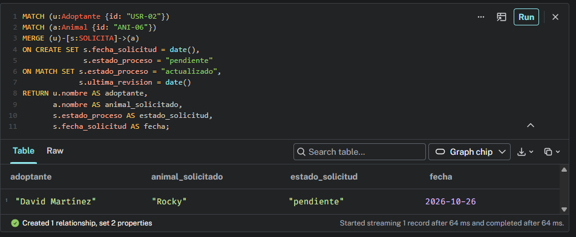
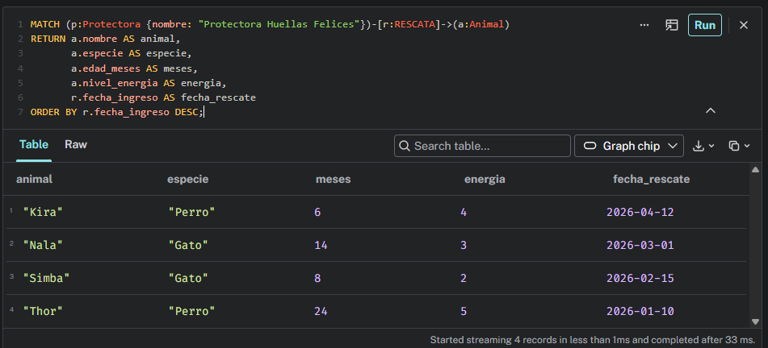
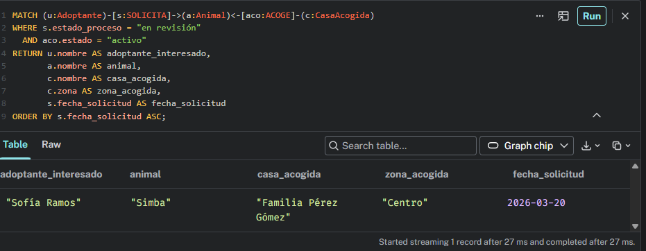
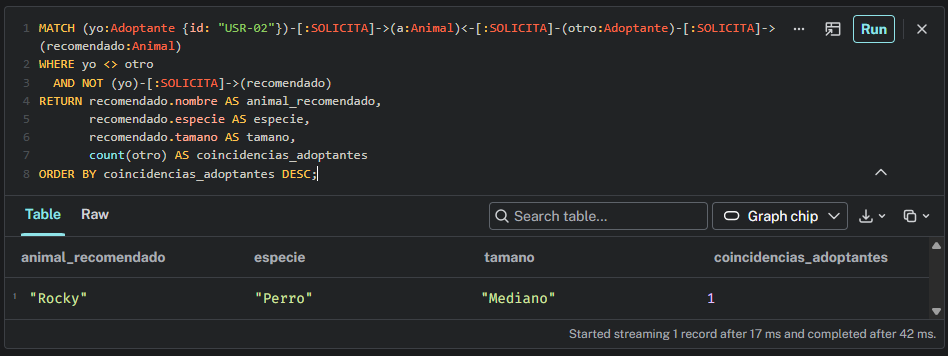
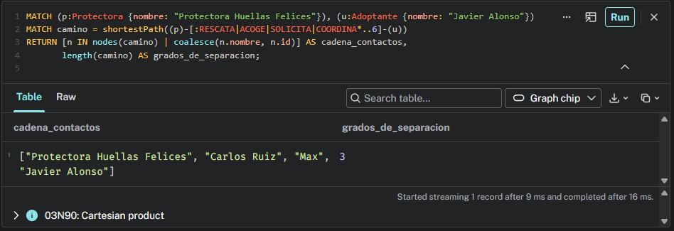

# 4. Resolver consultas Cypher y caminos complejos

## 4.1 Operación básica: Actualización transaccional idempotente (`MERGE` y `SET`)
Supongamos que un adoptante registra una nueva solicitud por un animal. La consulta crea la relación si no existe, o actualiza su estado si ya estaba en el sistema:

```cypher
MATCH (u:Adoptante {id: "USR-02"})
MATCH (a:Animal {id: "ANI-06"})
MERGE (u)-[s:SOLICITA]->(a)
ON CREATE SET s.fecha_solicitud = date(),
              s.estado_proceso = "pendiente"
ON MATCH SET s.estado_proceso = "actualizado",
             s.ultima_revision = date()
RETURN u.nombre AS adoptante,
       a.nombre AS animal_solicitado,
       s.estado_proceso AS estado_solicitud,
       s.fecha_solicitud AS fecha;
```
*Explicación:* Esta operación es vital para el backend de la plataforma. Garantiza que no se dupliquen las solicitudes en la base de datos, sino que simplemente se actualice el registro existente.



## 4.2 Consulta de 1 Salto: Vecinos inmediatos (Catálogo de la protectora)
¿Cuáles son todos los animales rescatados por la "Protectora Huellas Felices", indicando su especie, edad, nivel de energía y la fecha en la que ingresaron?

```cypher
MATCH (p:Protectora {nombre: "Protectora Huellas Felices"})-[r:RESCATA]->(a:Animal)
RETURN a.nombre AS animal,
       a.especie AS especie,
       a.edad_meses AS meses,
       a.nivel_energia AS energia,
       r.fecha_ingreso AS fecha_rescate
ORDER BY r.fecha_ingreso DESC;
```
*Explicación:* El motor localiza el nodo de la protectora y da un único "salto" a través de la relación `RESCATA` hacia los animales, ordenándolos del más reciente al más antiguo.



## 4.3 Consulta Multi-salto: Seguimiento de adopciones en casas de acogida
Para los animales que actualmente están en una casa de acogida (estado "activo"), queremos saber si ya tienen alguna solicitud de adopción "en revisión" y quién es el adoptante.

```cypher
MATCH (u:Adoptante)-[s:SOLICITA]->(a:Animal)<-[aco:ACOGE]-(c:CasaAcogida)
WHERE s.estado_proceso = "en revisión" 
  AND aco.estado = "activo"
RETURN u.nombre AS adoptante_interesado,
       a.nombre AS animal,
       c.nombre AS casa_acogida,
       c.zona AS zona_acogida,
       s.fecha_solicitud AS fecha_solicitud
ORDER BY s.fecha_solicitud ASC;
```
*Explicación:* Esta consulta encadena dos saltos (`Adoptante -> Animal <- CasaAcogida`). Permite al gestor organizar visitas cruzando la información de quién tiene al perro con quién quiere adoptarlo.



## 4.4 Recomendación por afinidad: "Adoptantes con tu perfil también miraron..."
Descubrir animales recomendados basándonos en el comportamiento de otros usuarios. Si a mí me interesa un perro, busco a otros adoptantes que también lo hayan solicitado y veo qué *otros* animales han pedido ellos.

```cypher
MATCH (yo:Adoptante {id: "USR-02"})-[:SOLICITA]->(a:Animal)<-[:SOLICITA]-(otro:Adoptante)-[:SOLICITA]->(recomendado:Animal)
WHERE yo <> otro 
  AND NOT (yo)-[:SOLICITA]->(recomendado)
RETURN recomendado.nombre AS animal_recomendado,
       recomendado.especie AS especie,
       recomendado.tamano AS tamano,
       count(otro) AS coincidencias_adoptantes
ORDER BY coincidencias_adoptantes DESC;
```
*Explicación:* Filtro colaborativo puro. Salta de mí al animal, del animal a otros interesados, y de esos interesados a otros animales que yo aún no he visto.



## 4.5 Algoritmo de Camino Más Corto (`shortestPath`): Grados de separación
¿Cuál es la ruta más corta de contactos (grados de separación) que une al adoptante "Javier Alonso" con la "Protectora Huellas Felices"?

```cypher
MATCH (p:Protectora {nombre: "Protectora Huellas Felices"}), (u:Adoptante {nombre: "Javier Alonso"})
MATCH camino = shortestPath((p)-[:RESCATA|ACOGE|SOLICITA|COORDINA*..6]-(u))
RETURN [n IN nodes(camino) | coalesce(n.nombre, n.id)] AS cadena_contactos,
       length(camino) AS grados_de_separacion;
```
*Explicación:* Neo4j busca la ruta óptima saltando a través de rescates y solicitudes de adopción, resolviendo el camino en un par de milisegundos.



## 4.6 Explicación técnica: Por qué Neo4j es tan rápido
Neo4j resuelve estos caminos en milisegundos gracias a la **adyacencia libre de índices (Index-Free Adjacency)**. 
- En **Neo4j**, cuando se crea una relación (por ejemplo, entre un Adoptante y un Animal), los nodos guardan en memoria un **puntero físico directo** hacia sus vecinos. Recorrer el grafo consiste simplemente en seguir esos punteros (direcciones de memoria), por lo que el coste temporal ($O(1)$ por salto) depende solo de la cantidad de datos que exploras, no del total de la base de datos.
- En una **Base de datos relacional (SQL)**, responder a la consulta multi-salto (4.3) requeriría encadenar tablas cruzadas mediante múltiples operaciones `JOIN`. Esto obliga al motor a realizar búsquedas en índices masivos y a calcular productos cartesianos al vuelo, lo que dispara el consumo de CPU y RAM.