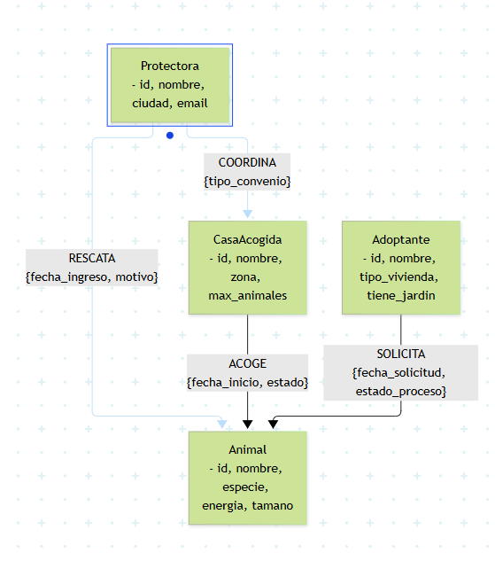

# Modelo de Datos y Arquitectura

## 2. Diseñar el grafo de nodos y relaciones

### 2.1 Diagrama visual del modelo (Mermaid)


### 2.2 Etiquetas de nodos y propiedades
1. **`:Animal`** (Mascota rescatada)
   - `id` (String, Obligatorio): Identificador único (ej. `"ANI-01"`).
   - `nombre` (String, Obligatorio).
   - `especie` (String, Obligatorio): Perro, gato, etc.
   - `raza` (String, Opcional).
   - `edad_meses` (Integer, Obligatorio).
   - `nivel_energia` (Integer, Obligatorio): Escala del 1 al 5.
   - `tamano` (String, Obligatorio).
   - `sociable_ninos` y `sociable_otros` (Boolean, Obligatorio).

2. **`:Protectora`** (Refugio u organización)
   - `id` (String, Obligatorio).
   - `nombre`, `ciudad`, `email` (String, Obligatorio).

3. **`:CasaAcogida`** (Voluntarios temporales)
   - `id` (String, Obligatorio).
   - `nombre`, `zona`, `espacio_vivienda` (String, Obligatorio).
   - `tiene_ninos` (Boolean, Obligatorio).
   - `max_animales` (Integer, Obligatorio).
   - `estado_disponible` (Boolean, Obligatorio).

4. **`:Adoptante`** (Interesados en adoptar)
   - `id` (String, Obligatorio).
   - `nombre`, `email`, `tipo_vivienda` (String, Obligatorio).
   - `tiene_jardin`, `experiencia_previa` (Boolean, Obligatorio).

### 2.3 Tipos de relación, dirección y propiedades
- **`(:Protectora)-[:RESCATA {fecha_ingreso, motivo}]->(:Animal)`**: Indica organización y fecha de rescate.
- **`(:CasaAcogida)-[:ACOGE {fecha_inicio, fecha_fin, estado}]->(:Animal)`**: Historial de estancias en hogares.
- **`(:Adoptante)-[:SOLICITA {fecha_solicitud, estado_proceso}]->(:Animal)`**: Conecta al interesado con la mascota.
- **`(:Protectora)-[:COORDINA {tipo_convenio}]->(:CasaAcogida)`**: Enlaza el refugio con sus casas colaboradoras.

### 2.4 Justificación de nodos frente a propiedades
Se modelan como nodos y no como atributos porque Protectora, CasaAcogida y Adoptante son entidades independientes cuyos datos evolucionan por separado. Múltiples animales se relacionan con ellos a lo largo del tiempo; tratarlos como nodos evita duplicar información y permite recorrer conexiones en milisegundos. El Animal es el nodo central porque actúa como nexo.

### 2.5 Identificadores y tipos de datos Cypher
Se usan códigos alfanuméricos estandarizados (`"ANI-01"`, `"REF-01"`) respaldados por restricciones de unicidad (`IS UNIQUE`). Se emplean tipos nativos: `String` (textos), `Integer` (edades/escalas), `Boolean` (compatibilidad) y `Date`.

### 2.6 Prevención de supernodos
Protectoras muy grandes con miles de rescates históricos podrían convertirse en supernodos. Para evitar cuellos de botella, las consultas nunca parten de la protectora abierta (`MATCH (p)-[*]-(a)`), sino que acotan siempre usando filtros geográficos, estados activos o limitando la profundidad de los saltos (`*1..3`).

---

## 5. Comparación técnica, seguridad y copias

### 5.1 Comparativa técnica frente a SQL y Documentos
Tomando como referencia la consulta de recomendación colaborativa (Adoptantes con tu perfil también miraron...):

| Criterio | Solución en Neo4j (Grafos) | Solución en PostgreSQL (SQL Relacional) | Solución en MongoDB (Documental) |
| :--- | :--- | :--- | :--- |
| **Sintaxis** | Patrón visual de 5 líneas con `MATCH (yo)-[:SOLICITA]->(a)<-[:SOLICITA]-(otro)`. | 3 o 4 sentencias `JOIN` cruzando tablas y `WHERE NOT IN`. | Múltiples etapas `$lookup` con `$unwind` cruzando arrays. |
| **Mecánica interna** | **Index-Free Adjacency:** el cursor salta por los punteros físicos de memoria directamente. | Búsquedas B-Tree sobre la tabla global y productos cartesianos en RAM. | Carga documentos completos con arrays desnormalizados, consumiendo RAM/CPU. |
| **Complejidad temporal** | $O(k)$ proporcional solo a los adoptantes afines directos. | $O(N \cdot \log M)$ donde el coste escala por el tamaño global de las tablas. | Elevada si los historiales no están paginados. |

### 5.2 Procedimiento de copia de seguridad (Terminal bash)
```bash
# 1. Volcado físico completo
neo4j-admin database dump neo4j --to-path=/var/backups/neo4j/red_adopciones_$(date +%F).dump

# 2. Restauración
neo4j-admin database load neo4j --from-path=/var/backups/neo4j/red_adopciones_2026-10-26.dump --overwrite-destination=true
```

### 5.3 Usuarios y Principio de Mínimo Privilegio (RBAC)
```cypher
// Rol de lectura (App Adoptantes)
CREATE USER app_adoptantes SET PASSWORD 'AppAdoptantes_2026!' CHANGE NOT REQUIRED;
GRANT ROLE reader TO app_adoptantes;

// Rol de edición (Gestor de Protectora)
CREATE USER gestor_protectora SET PASSWORD 'GestorProtectora_2026!' CHANGE NOT REQUIRED;
GRANT ROLE publisher TO gestor_protectora;
```

### 5.4 Cuándo NO usar Neo4j
1. **Analítica y facturación masiva:** Sumar donaciones de 50.000 socios para modelos fiscales trimestrales es trabajo para una base de datos columnar o relacional pura.
2. **Telemetría IoT (Collares GPS):** Almacenar "pings" de ubicación cada 5 segundos saturaría el grafo. Requiere una base de datos Time-Series.