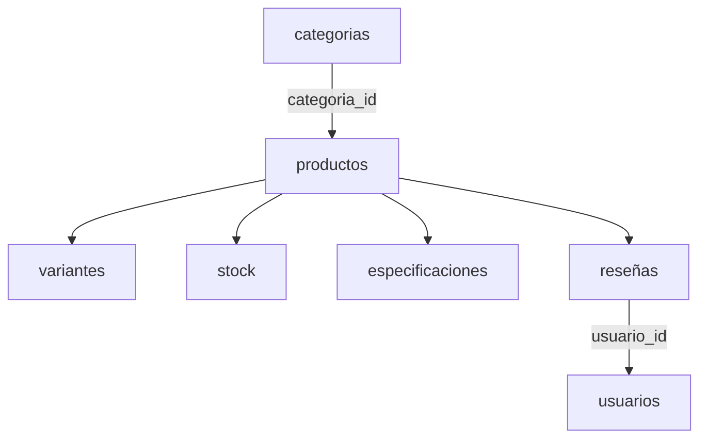

[
  {
    "_id": "PROD001",
    "nombre": "Auriculares Bluetooth Pro",
    "descripcion": "Auriculares inalámbricos con cancelación de ruido",
    "categoria": {
      "id": "CAT001",
      "nombre": "Electrónica",
      "subcategoria": "Audio"
    },
    "marca": "SoundMax",
    "precio": 79.99,
    "activo": true,
    "variantes": [
      {
        "sku": "AUDPRO-BLK",
        "color": "Negro",
        "memoria": "32GB",
        "precio": 79.99,
        "stock": 25
      },
      {
        "sku": "AUDPRO-WHT",
        "color": "Blanco",
        "memoria": "32GB",
        "precio": 84.99,
        "stock": 12
      }
    ],
    "especificaciones": {
      "bluetooth": "5.3",
      "bateria_horas": 30,
      "cancelacion_ruido": true,
      "peso_gramos": 250
    },
    "stock": {
      "total": 37,
      "almacenes": [
        {
          "almacen": "MAD01",
          "ciudad": "Madrid",
          "unidades": 20
        },
        {
          "almacen": "BCN01",
          "ciudad": "Barcelona",
          "unidades": 17
        }
      ]
    },
    "resenas": [
      {
        "usuario_id": "USR001",
        "puntuacion": 5,
        "comentario": "Muy buena calidad de sonido.",
        "fecha": "2026-09-10"
      },
      {
        "usuario_id": "USR002",
        "puntuacion": 4,
        "comentario": "La batería dura bastante.",
        "fecha": "2026-09-15"
      }
    ],
    "etiquetas": [
      "bluetooth",
      "inalambrico",
      "cancelacion-ruido"
    ],
    "fecha_creacion": "2026-08-01",
    "fecha_actualizacion": "2026-09-20"
  }
]

# Modelo de Datos Documental - Catálogo de Comercio Electrónico

En este documento explico cómo he organizado la base de datos de la tienda online y por qué he elegido esta estructura en MongoDB.

---

## 1. Diagrama del modelo

He creado tres colecciones: `productos`, `categorias` y `usuarios`.

Los productos están relacionados con las categorías mediante `categoria_id`. Las variantes, el stock, las especificaciones y las reseñas se guardan dentro de cada producto.

Las reseñas también contienen el identificador del usuario que ha escrito cada opinión.

---

## 2. Datos incrustados y referencias

### A) Datos incrustados

He guardado algunos datos dentro de los documentos de `productos`:

- **Variantes:** permiten guardar las distintas opciones de un producto, como el color o el tamaño.
- **Stock:** guarda las existencias disponibles del producto.
- **Especificaciones:** permite añadir características diferentes según el tipo de producto.
- **Reseñas:** guardan la puntuación, el comentario y el identificador del usuario.

He elegido esta opción porque normalmente estos datos se consultan junto con el producto. Así no necesito hacer varias consultas para obtener toda su información.

Si un producto llegara a tener muchísimas reseñas, sería mejor guardarlas en una colección independiente para evitar que el documento creciera demasiado.

### B) Referencias

He utilizado referencias para relacionar las colecciones:

- **Productos y categorías:** cada producto utiliza `categoria_id` para indicar a qué categoría pertenece.
- **Reseñas y usuarios:** cada reseña contiene `usuario_id`, que permite identificar al usuario sin repetir sus datos personales.

De esta forma, la información de las categorías y los usuarios se guarda una sola vez y se puede relacionar con otros documentos cuando sea necesario.

---

## 3. Identificadores, fechas y estados

- **Identificadores:** he utilizado identificadores de texto como `PROD001`, `CAT001` y `USR001`. Son fáciles de reconocer y permiten distinguir los documentos.
- **Fechas:** en los productos y las reseñas he utilizado fechas de MongoDB con `Date` para poder trabajar con ellas en consultas.
- **Estado de los productos:** utilizo el campo `activo` para indicar si un producto está disponible en el catálogo. Si deja de venderse, puedo ponerlo a `false` sin eliminarlo definitivamente.

Esta organización permite identificar los documentos fácilmente y mantener los datos ordenados.

---

## 4. Límites del modelo y posibles mejoras

Hay algunos aspectos que tendría en cuenta si la tienda creciera:

1. **Cantidad de reseñas:** si un producto acumula demasiadas opiniones, las movería a una colección independiente para que el documento no creciera sin control.
2. **Tamaño de los documentos:** MongoDB tiene un límite de 16 MB por documento. Por eso es importante controlar el tamaño de los arrays y no guardar cantidades ilimitadas de datos dentro de un producto.
3. **Búsquedas y rendimiento:** si aumentara mucho el número de productos, utilizaría índices para mejorar las consultas más habituales.
4. **Datos de los usuarios:** guardaría solo la información necesaria y evitaría repetir datos personales dentro de los productos y las reseñas.

En general, considero que este modelo es adecuado para una tienda online pequeña o mediana, porque permite guardar productos con características diferentes y consultar su información de forma sencilla.